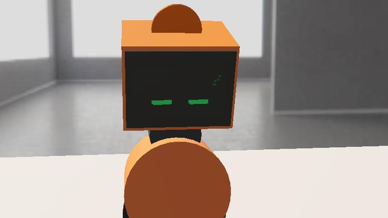
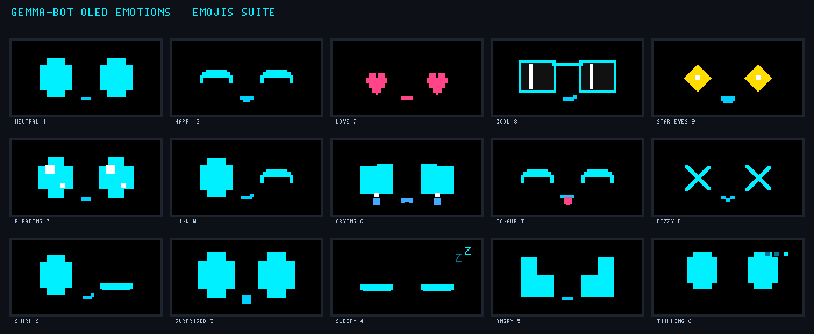
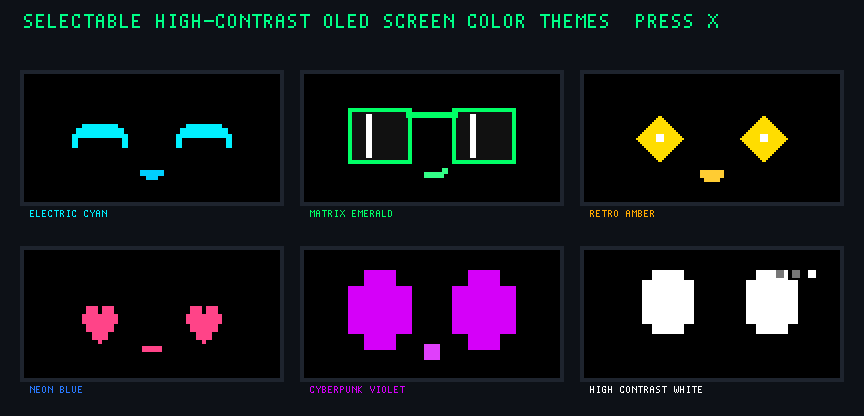

# 🤖 Gemma-Bot: Webots Desktop Companion Simulation

A complete Webots simulation of **Gemma-Bot**, an expressive desktop companion robot with built-in **AI Command Integration**.


<div align="center">
  
  <p><em>Gemma-Bot desktop companion robot rendered inside Cyberbotics Webots with high-contrast OLED display.</em></p>
</div>

---

## ✨ Features

- **AI Command Integration (`ai_assistant.py` + `intent_parser.py`)**: Send English, Telugu, or Tanglish prompts (parsed via Sarvam structured JSON output with strict allowlist validation and word-boundary keyword fallback) or raw JSON commands to control gestures, moods, gaze, and speech.
- **Pluggable Speech & Audio-Duration Lip-Sync (`tts.py`)**: Supports `MacSayTTS` (default on macOS), `SarvamTTS` (Bulbul v3 cloud TTS for Telugu/Indian languages and Raspberry Pi Zero), and `NullTTS`, synchronizing OLED mouth animation to actual WAV audio duration when available.
- **Whisper-Quiet Servos**: Motor whining sounds are completely muted via `sound ""` configuration for clean, silent motion.
- **Integrated Sarvam Voice Pipeline (`voice_server/` + `voice_client/` + `gemma_talk_bridge.py`)**: Self-contained full-duplex voice assistant inside `gemma-bot` using Silero VAD, AI4Bharat/Whisper STT, **Sarvam AI** streaming LLM (`sarvam-105b`) & TTS (`bulbul:v3`), React web UI, and `/ws/events` bridge sync with barge-in preemption.
- **High-Contrast OLED Screen & Selectable Color Themes**: 128×64 pixel display (`faces/`) shared with `scripts/generate_readme_assets.py` across 6 switchable themes.
- **Phase-Based Gesture Engine (`gestures.py`)**: 19 unified phase-normalized trajectory gestures (`nod`, `shake`, `wiggle`, `curious`, `tilt_left`, `tilt_right`, `perk_up`, `droop`, `bounce`, `groove`, `shiver`, `scan`, `confused`, `bow`, `cheer`, `yawn`, `shy`, `peek_a_boo`, `dizzy_spin`).
- **Hardened Multi-Threaded HTTP Command Server (`server.py`)**: Runs `ThreadingHTTPServer` on `127.0.0.1:8765` by default (configured via `config.py`) with `X-Bot-Token` authentication, 413 payload limits, and JSON schema validation.
- **Autonomous Idle Life**: Automatically glances around the room, blinks naturally, and exhibits organic micro-movements when idle.

---

## 🎭 Expressive OLED Expressions Suite

Gemma-Bot features 15 distinct animated companion moods and emoji expressions rendered on its 128×64 OLED visor:

<div align="center">
  
</div>

---

## 🎨 Selectable Screen Color Themes

You can customize the robot's screen colors at runtime. Press **`X`** in the Webots window, use natural language in the CLI, or send a JSON command:

<div align="center">
  
</div>

| Theme | Accent Color | Description | Quick CLI Command |
| :--- | :---: | :--- | :--- |
| **Electric Cyan** | `#00F0FF` | Default vibrant neon OLED cyan | `python3 ai_assistant.py "cyan screen"` |
| **Matrix Emerald** | `#00FF66` | Retro phosphor green terminal | `python3 ai_assistant.py "green screen"` |
| **Retro Amber** | `#FFAA00` | Warm golden amber CRT glow | `python3 ai_assistant.py "amber screen"` |
| **Neon Blue** | `#2979FF` | Deep electric sapphire blue | `python3 ai_assistant.py "blue screen"` |
| **Cyberpunk Violet** | `#D500F9` | Vivid futuristic magenta/purple | `python3 ai_assistant.py "purple screen"` |
| **High Contrast White** | `#FFFFFF` | Crisp classic monochrome OLED | `python3 ai_assistant.py "white screen"` |

---

## 🚀 Setup & Quick Start

### Installation
```bash
git clone <your-fork-or-repo-url> gemma-bot
cd gemma-bot
python3 -m venv .venv
source .venv/bin/activate
pip install -r requirements.txt
cp .env.example .env   # optional: customize ports, tokens, TTS, or Sarvam API key
```

For full voice server dependencies (Silero VAD, STT, FastAPI/uvicorn):
```bash
pip install -r requirements-voice.txt
cd voice_client && npm install && cd ..
```

For development and tests:
```bash
pip install -r requirements-dev.txt
pytest
```

### 1-Command All-In-One Launcher
To launch **everything** from within `gemma-bot` (Webots simulation in real-time mode, `voice_server` with Sarvam AI, `gemma_talk_bridge.py` with logging to `logs/gemma_talk_bridge.log`, and `voice_client` web UI):

```bash
./start_all.sh
```

When running, just speak naturally into your microphone! Press **Ctrl+C** anytime to cleanly stop all services.

### Review-plan concept world

`worlds/gemabot_review_plan.wbt` is the stationary GemaBot from the review-plan renders (tapered base, chamfered head, orange accents, clock dock) on a desk. It uses this same controller and the Sarvam pipeline with no API changes. `worlds/gemma_bot.wbt` is unchanged.

```bash
git fetch origin demo/review-plan-world
git checkout demo/review-plan-world
```

Open `worlds/gemabot_review_plan.wbt` in Webots R2025a and press Play. For `./start_all.sh`, set `SARVAM_API_KEY`, `WEBOTS_APP`, and `GEMMA_WORLD_PATH` to this world. Exact commands, including the voice server, are in [`docs/DEMO_REVIEW_PLAN.md`](docs/DEMO_REVIEW_PLAN.md).

---

## 🏗️ Architecture

```text
+-------------------+     WS (/ws) audio       +-----------------------------+
|  voice_client/    | <======================> |       voice_server/         |
|  (React + Vite)   |                          | Silero VAD + STT + Chunker  |
+-------------------+                          | Sarvam Streaming LLM + TTS  |
                                               +--------------+--------------+
                                                              | WS (/ws/events)
                                                              v
+-------------------+   LLM / Keyword Intent   +--------------+--------------+
|  ai_assistant.py  | --------------------+    |    gemma_talk_bridge.py     |
| (intent_parser.py)|                     |    | (async + health/backoff)    |
+-------------------+                     |    +--------------+--------------+
                                          v                   | HTTP POST /command
                                   +------+-------------------+--+  (X-Bot-Token)
                                   |     BotCommandHTTPServer    |
                                   |    (ThreadingHTTPServer)    |
                                   +--------------+--------------+
                                                  | COMMAND_QUEUE
                                                  v
+-------------------------------------------------+--------------------------+
| Webots Controller (controllers/gemma_bot_controller/gemma_bot_controller.py)|
|  - input_map.py (KEYMAP + edge-triggered head_touch)                       |
|  - gestures.py  (phase-normalized GESTURES registry, p in [0, 1])          |
|  - faces/       (FaceRenderer shared with scripts/generate_readme_assets)  |
|  - tts.py       (MacSayTTS / SarvamTTS / NullTTS -> audio-duration lipsync)|
+----------------------------------------------------------------------------+
```

---

## ⚙️ Environment Variables (`.env.example`)

All defaults live in `config.py` and can be overridden via environment variables or `.env`:

| Variable | Default | Description |
| :--- | :--- | :--- |
| `GEMMA_BOT_HOST` | `127.0.0.1` | Bind host (`0.0.0.0` requires `GEMMA_BOT_TOKEN`) |
| `GEMMA_BOT_PORT` | `8765` | Embedded HTTP command server port |
| `GEMMA_BOT_URL` | `http://<host>:<port>` | Base URL used by `ai_assistant.py` & bridge |
| `GEMMA_BOT_TOKEN` | `""` | Shared secret checked via `X-Bot-Token` |
| `GEMMA_MAX_BODY_BYTES` | `16384` | Max `/command` JSON body size before `413` |
| `GEMMA_TALK_WS_URL` | `ws://127.0.0.1:8000/ws/events` | Voice server event stream URL for bridge |
| `GEMMA_VOICE_HOST` | `0.0.0.0` | Integrated `voice_server` bind host |
| `GEMMA_VOICE_PORT` | `8000` | Integrated `voice_server` port |
| `GEMMA_VOICE_CLIENT_PORT` | `5173` | Integrated `voice_client` Vite port |
| `GEMMA_VOICE_TTS_ENGINE` | `sarvam` if key set else `kokoro` | Voice server PCM synthesizer (`sarvam` or `kokoro`) |
| `GEMMA_STT_ENGINE` | `sarvam` if key set else `ai4bharat` | Speech-to-text engine (`sarvam`, `ai4bharat`, or `whisper`) |
| `GEMMA_SARVAM_STT_MODEL` | `saaras:v4` | Sarvam STT model (`POST /speech-to-text`) |
| `GEMMA_MODELS_DIR` | `./voice_server/models` | Directory containing `silero_vad.onnx` (and optional Kokoro models) |
| `WEBOTS_APP` | `/Applications/Webots.app/Contents/MacOS/webots` | Webots executable path |
| `GEMMA_TTS_PROVIDER` | `mac_say` (macOS) / `null` (other) | `mac_say`, `sarvam`, or `null` |
| `GEMMA_TTS_MAC_VOICE` | `Samantha` | macOS `say` voice name |
| `SARVAM_API_KEY` | `""` | Sarvam AI key (env-only; never commit) |
| `GEMMA_SARVAM_TTS_MODEL` | `bulbul:v3` | Sarvam TTS model (`bulbul:v3` / `bulbul:v4-flash`) |
| `GEMMA_SARVAM_TTS_SPEAKER` | `shubh` | Sarvam TTS voice persona |
| `GEMMA_SARVAM_TTS_LANGUAGE` | `en-IN` | Default BCP-47 language (auto-switches `te-IN` for Telugu script) |
| `GEMMA_INTENT_PROVIDER` | `sarvam` if key set else `keyword` | `sarvam` or `keyword` |
| `GEMMA_SARVAM_LLM_MODEL` | `sarvam-105b` | Sarvam Chat Completions model |
| `GEMMA_INTENT_TIMEOUT` | `4.0` | Timeout (seconds) before falling back to keyword parser |

---

## 🛠️ Individual Manual Controls

### 1. Launch in Webots Manually
1. Open **Webots**.
2. Go to **File → Open World...** and select `worlds/gemma_bot.wbt`.
3. Press the **Play (▶)** button on the top toolbar.

### 2. Send AI Commands (via Terminal)

In a terminal, run:

```bash
# Quick single natural language commands (English, Telugu, or Tanglish with Sarvam):
python3 ai_assistant.py "nod yes and smile"
python3 ai_assistant.py "look left and act surprised"
python3 ai_assistant.py "shake your head no"
python3 ai_assistant.py "green screen"
python3 ai_assistant.py "curious"
python3 ai_assistant.py "perk up"
python3 ai_assistant.py "tell me a joke"
python3 ai_assistant.py "go to sleep"
python3 ai_assistant.py "I love you"

# Interactive AI conversation shell:
python3 ai_assistant.py -i

# Check live robot telemetry:
python3 ai_assistant.py --status
```

---

## 🎙️ Running Voice Assistant Components Individually

1. **Start the Integrated Sarvam Voice Server**:
   ```bash
   python3 -m uvicorn voice_server.main:app --host 0.0.0.0 --port 8000
   ```
2. **Start the Bridge**:
   ```bash
   python3 gemma_talk_bridge.py
   ```
3. **Start the Web UI (`voice_client/`)**:
   ```bash
   cd voice_client && npm run dev
   ```
   Open `http://localhost:5173`:
   - When you speak, Gemma-Bot enters **LISTENING** mode (head perks up, eyes focus).
   - When Sarvam AI streams the response, Gemma-Bot enters **THINKING** mode (curious head tilt, eyes look up with thinking dots).
   - When audio plays, Gemma-Bot enters **SPEAKING** mode (animated lip-sync, happy smile, conversational nodding).
   - When you interrupt (barge-in), Gemma-Bot instantly silences speech, halts its mouth, and blinks attentively!

---

## 🌐 AI API Specification (`POST http://127.0.0.1:8765/command`)

You can also send JSON commands directly using `curl` or any language:

```bash
curl -X POST http://127.0.0.1:8765/command \
     -H "Content-Type: application/json" \
     -d '{
       "mood": "HAPPY",
       "gesture": "nod",
       "screen_color": "AMBER",
       "gaze": "left",
       "speech": "I am Gemma-Bot!"
     }'
```

### Supported JSON Parameters:
| Parameter | Type | Options / Values |
| :--- | :--- | :--- |
| `mood` | string / emoji | `"NEUTRAL"`, `"HAPPY"`, `"COOL"`, `"STAR_EYES"`, `"PLEADING"`, `"CRYING"`, `"WINK"`, `"TONGUE"`, `"LOVE"`, `"DIZZY"`, `"SMIRK"`, `"SURPRISED"`, `"SLEEPY"`, `"ANGRY"`, `"THINKING"` (or raw emojis: `😎`, `🤩`, `🥺`, `😭`, `😉`, `😋`, `😍`, `😵`, `😏`, `😀`, `😮`, `😴`, `😡`, `🤔`) |
| `gesture` | string | `"nod"`, `"shake"`, `"wiggle"`, `"curious"`, `"tilt_left"`, `"tilt_right"`, `"perk_up"`, `"droop"`, `"bounce"`, `"groove"`, `"shiver"`, `"scan"`, `"confused"`, `"bow"`, `"cheer"`, `"yawn"`, `"shy"`, `"peek_a_boo"`, `"dizzy_spin"` |
| `screen_color` | string | `"CYAN"`, `"GREEN"`, `"AMBER"`, `"BLUE"`, `"PURPLE"`, `"WHITE"` |
| `gaze` | string | `"left"`, `"right"`, `"up"`, `"down"`, `"center"` |
| `look_at` | array `[yaw, pitch]` | e.g. `[0.4, -0.2]` (custom servo angles) |
| `speech` | string | Spoken dialogue printed to console, spoken out loud, & animated on OLED display |

---

## 🍓 Raspberry Pi Zero Thin-Client LAN Setup

To control Gemma-Bot from a Raspberry Pi Zero (or any other host on your LAN) while Webots/the controller runs on your workstation:

1. **Generate a shared token** (never commit it; keep it in `.env` or shell environment):
   ```bash
   export GEMMA_BOT_TOKEN="$(python3 -c 'import secrets; print(secrets.token_urlsafe(32))')"
   ```
2. **On the host running the controller**, bind all interfaces with the token set (the server refuses to bind `0.0.0.0` without `GEMMA_BOT_TOKEN`):
   ```bash
   export GEMMA_BOT_HOST=0.0.0.0
   export GEMMA_BOT_PORT=8765
   export GEMMA_BOT_TOKEN="<your-token>"
   ```
   Restrict port `8765` in your host firewall to your local LAN subnet.
3. **On the Raspberry Pi Zero thin client**, point the client or bridge to the host's LAN IP and pass the same token:
   ```bash
   export GEMMA_BOT_URL="http://<host-lan-ip>:8765"
   export GEMMA_BOT_TOKEN="<your-token>"
   python3 ai_assistant.py "nod yes and smile"
   ```
   Direct `curl` requests must include `-H "X-Bot-Token: $GEMMA_BOT_TOKEN"`. Oversized payloads (> `GEMMA_MAX_BODY_BYTES`, default 16 KB) return `413`, invalid JSON/types return `400`, and missing/invalid tokens return `401`.

---

## 🎮 Manual Keyboard Controls

Click into the 3D Webots viewport and use your keyboard:

### Face Emojis & Display:
| Key | Emoji / Mood | Expression |
| :---: | :--- | :--- |
| `1` | **Neutral 😐** | Natural random blinks and organic idle gaze |
| `2` | **Happy 😀** | Squinting smiling eyes (`^_^`) and bright smile |
| `3` | **Surprised 😮** | Wide round eyes and 'O' mouth |
| `4` | **Sleepy 😴** | Drooping eyelids, resting slump, floating Zzz |
| `5` | **Angry 😡** | Inward slanted aggressive brows |
| `6` | **Thinking 🤔** | Looking up-right with cycling thinking dots |
| `7` | **Love 😍** | Glowing pixel heart eyes and pink companion smile |
| `8` | **Cool 😎** | Pixelated sunglasses with white gloss reflection streaks and smirk |
| `9` | **Star Eyes 🤩** | Twinkling 4-point yellow star eyes with shiny centers |
| `0` | **Pleading 🥺** | Giant sparkly anime puppy eyes with specular highlights |
| `W` | **Wink 😉** | One open rounded eye, one winking smile arc |
| `C` | **Crying 😭** | Sad drooping eyes with animated flowing blue teardrops |
| `T` | **Tongue 😋** | Squinting happy eyes with cute pink tongue |
| `D` | **Dizzy 😵** | Cross `X_X` eyes and wavy mouth |
| `S` | **Smirk 😏** | Asymmetric eyebrow, sly side glance and smirk |
| `X` | **Cycle Screen Color** | Cycle themes: Cyan → Green → Amber → Blue → Purple → White |

### Physical Head Gestures:
| Key | Gesture | Motion Description |
| :---: | :--- | :--- |
| `N` | **Nod** | Smooth double nodding agreement up & down |
| `H` | **Shake** | Head shaking left & right (disagreement) |
| `B` | **Bounce** | Fast vertical energetic bobbing |
| `G` | **Groove / Dance** | Smooth figure-8 head groove |
| `V` | **Shiver / Tremble** | High-frequency micro-jitter (cold or nervous) |
| `R` | **Scan / Search** | Sweeping panoramic room scan with wide gaze |
| `P` | **Perk Up** | Sudden attentive upward head rise |
| `Y` | **Yawn** | Stretching upward tilt then relaxing slump |
| `O` | **Bow** | Polite formal bow forward |
| `U` | **Confused** | Puzzled alternating tilt left and right |
| `Z` | **Dizzy Spin** | Smooth orbital circular head roll |
| `J` | **Cheer** | Head tossed back in joy with happy shakes |
| `K` | **Shy** | Head turns away and tucks down |
| `Q` | **Peek-a-Boo** | Dips head with closed eyes, then pops up! |
| `[` | **Tilt Left** | Sustained curious head tilt left |
| `]` | **Tilt Right** | Sustained curious head tilt right |
| `SPACE` | **Pet / Wiggle** | Joyful companion shimmy |
| `←` / `→` | **Pan Head** | Manual servo pan left/right |
| `↑` / `↓` | **Tilt Head** | Manual servo tilt up/down |
